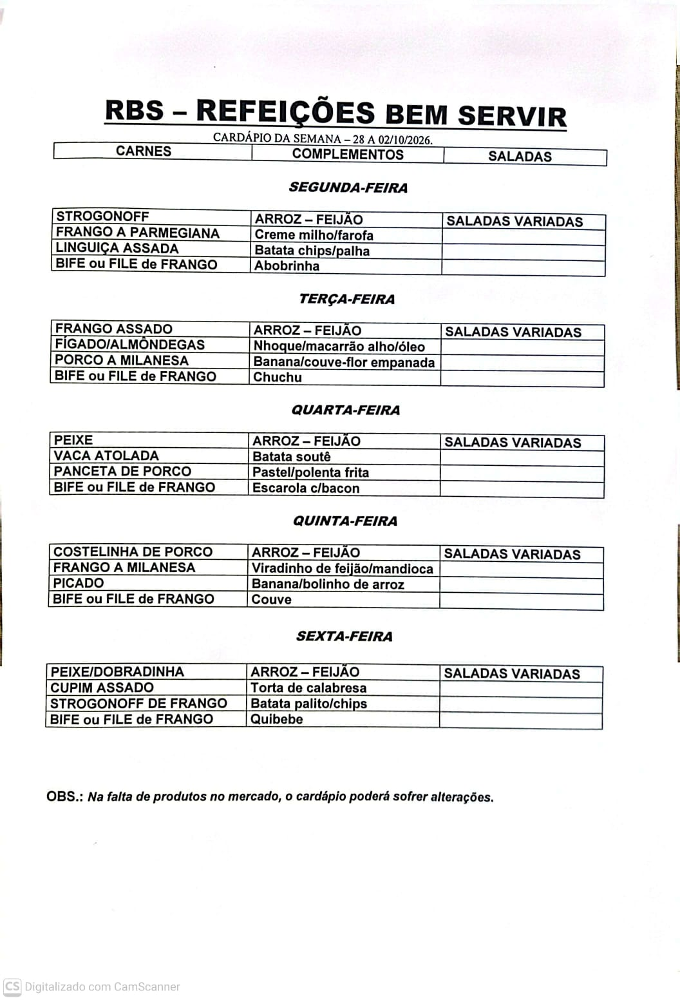

# Estudo de Negócio — RBS Refeições Bem Servir

> Documento vivo. Toda regra nova ou alterada deve ser registrada aqui **e** resumida no [README](../README.md#regras-de-negócio-definidas).
> Convenção: cada regra recebe um código `RN-XX`, cada dúvida em aberto um código `Q-XX`.
> Status possíveis: ✅ Definida · 🟡 Proposta (aguardando validação) · ❓ Em aberto.

---

## 1. Contexto

O restaurante **RBS – Refeições Bem Servir** funciona de **segunda a sexta-feira**, exceto feriados que caem nesses dias. Toda semana a gerente (proprietária) monta um **cardápio novo** e o envia **manualmente pelo WhatsApp Business** a clientes frequentes:

- clientes que pedem **marmita**;
- clientes que só querem **saber o cardápio** para se programar.

Ela **não quer publicar o cardápio inteiro nas redes sociais**, por receio de que concorrentes copiem.

### Dores atuais

| # | Dor | Impacto |
|---|-----|---------|
| D1 | Envio manual do cardápio para cada cliente | Tempo gasto toda semana, risco de esquecer alguém |
| D2 | Pedidos de marmita chegam soltos pelo WhatsApp | Difícil acompanhar e organizar a produção, risco de perder pedidos |
| D3 | Elogios, reclamações e solicitações misturados nas conversas | Nada fica registrado nem tratado de forma organizada |
| D4 | Cardápio refeito do zero toda semana | Retrabalho com formato e impressão |

### Objetivos do sistema

1. **Automatizar o atendimento** pelo WhatsApp com um chatbot.
2. **Centralizar** cardápio, pedidos e feedbacks em um painel da gerente.
3. **Proteger o cardápio**: mostrar só o necessário ao público.
4. **Preparar para o futuro**: pedidos feitos pelo site por clientes com login.

---

## 2. Atores (perfis de usuário)

| Ator | Descrição | Fase |
|------|-----------|------|
| **Visitante** (deslogado) | Qualquer pessoa no site público. Vê o cardápio **do dia**. | MVP |
| **Cliente WhatsApp** | Conversa com o chatbot. Identificado pelo número de telefone, sem login. | MVP |
| **Gerente** (`ADMIN`) | A proprietária, única usuária do painel, com acesso total. Gerencia cardápio, chatbot, pedidos e feedbacks. | MVP |
| **Cliente cadastrado** (`CUSTOMER`) | Cliente com login no site, que faz pedidos pelo site. | Futuro |
| **Funcionário** (`STAFF`) | Reservado. Hoje não há funcionários usando o sistema (Q-13). | Futuro |

> **Decisão de modelagem:** o *usuário* (quem faz login) fica separado do *cliente* (quem compra). Um cliente de WhatsApp existe sem login; quando ele criar uma conta no futuro, os dois são **vinculados pelo telefone**, e o histórico de pedidos é preservado. Ver [MODELAGEM_DADOS.md](./MODELAGEM_DADOS.md).

---

## 3. Módulos e fluxos

### 3.1 Calendário de funcionamento

| Código | Regra | Status |
|--------|-------|--------|
| RN-01 | O restaurante funciona de segunda a sexta. | ✅ |
| RN-02 | Feriados que caem de segunda a sexta são dias **fechados**: sem cardápio e sem pedidos. | ✅ |
| RN-03 | Feriados nacionais são importados automaticamente (BrasilAPI). Feriados estaduais/municipais e folgas pontuais são cadastrados manualmente pela gerente. | 🟡 |
| RN-04 | A gerente pode marcar qualquer dia útil como fechado (ex.: emenda, imprevisto). | 🟡 |
| RN-05 | **Horário de funcionamento** do restaurante: **11h00 às 14h00**. | ✅ |
| RN-06 | **Entregas** acontecem até **12h00**. Os pedidos com entrega vão até 11h30 (RN-75). | ✅ |

### 3.2 Cardápio

**Formato atual (referência):** [`referencias/cardapio-exemplo.jpg`](./referencias/cardapio-exemplo.jpg)



Estrutura observada no exemplo:

| Elemento | Exemplo | Comportamento no sistema |
|----------|---------|--------------------------|
| Cabeçalho | "RBS – REFEIÇÕES BEM SERVIR" | Texto configurável |
| Período | "CARDÁPIO DA SEMANA – 28 A 02/10/2026" | Gerado automaticamente a partir das datas da semana cadastrada (muda a cada semana) |
| Colunas (seções) | CARNES · COMPLEMENTOS · SALADAS | **Personalizáveis**: criar, renomear, reordenar, remover |
| Linhas por dia | 4 linhas por dia | Quantidade livre por seção |
| Itens fixos | "BIFE ou FILÉ de FRANGO" (Carnes), "ARROZ – FEIJÃO" (Complementos), "SALADAS VARIADAS" (Saladas) | Vêm **pré-preenchidos** todos os dias pelo modelo, mas **podem ser editados ou removidos** em qualquer dia |
| Itens variáveis | Strogonoff, Frango à parmegiana, Batata soutê... | Preenchidos pela gerente a cada semana |
| Rodapé | "OBS.: Na falta de produtos no mercado, o cardápio poderá sofrer alterações." | Texto configurável |

**Fluxo:**
```
Gerente abre "Nova semana"
   → sistema sugere a PRÓXIMA semana (segunda a sexta seguinte)
     e calcula o período do cabeçalho (ex.: "28 A 02/10/2026")
   → cria seg–sex a partir do MODELO (seções + itens fixos)
     ou copia a semana anterior
   → dias fechados (feriados) já vêm marcados
   → ela preenche os itens variáveis e ajusta os fixos, se quiser
   → salva como RASCUNHO
   → PUBLICA → cardápio passa a valer no site e no chatbot
   → imprime (layout igual ao exemplo, 1 página A4)
```

| Código | Regra | Status |
|--------|-------|--------|
| RN-10 | O cardápio é **semanal** (segunda a sexta) e organizado **por dia**. | ✅ |
| RN-11 | O cardápio segue um **modelo totalmente personalizável**: seções (colunas), ordem, itens fixos pré-preenchidos, cabeçalho e rodapé. O modelo padrão reproduz o cardápio atual (Carnes, Complementos, Saladas). **Itens pré-preenchidos também podem ser editados ou removidos** em cada dia, sem alterar o modelo. | ✅ |
| RN-12 | O cardápio tem status `RASCUNHO` → `PUBLICADO`. Só o publicado aparece no site e no chatbot. | 🟡 |
| RN-13 | Ao publicar/alterar o cardápio, o chatbot passa a usar os novos dados **imediatamente** (fonte única de verdade: o banco). | ✅ |
| RN-14 | O cardápio pode ser **impresso** seguindo o layout do [exemplo](./referencias/cardapio-exemplo.jpg): título, período, cabeçalho das seções, um bloco por dia em tabela, rodapé de observação, tudo em **1 página A4 retrato**. | ✅ |
| RN-15 | O site público mostra **apenas o cardápio do dia**, nunca a semana inteira (proteção contra cópia). | ✅ |
| RN-16 | O cliente pode **pedir o cardápio pelo chat a qualquer momento** (opção 1): o bot mostra o cardápio do dia e oferece o da semana. | ✅ |
| RN-17 | Opção "copiar semana anterior" para reaproveitar pratos recorrentes. | 🟡 |
| RN-18 | O **período** do cabeçalho é calculado a partir das datas da semana cadastrada, no formato do exemplo: `DD A DD/MM/AAAA` (ex.: "28 A 02/10/2026"). | ✅ |
| RN-19 | O cardápio é cadastrado **para a próxima semana**: "Nova semana" sugere a segunda-feira seguinte. A gerente pode escolher outra semana, se precisar. | ✅ |

### 3.3 Chatbot (WhatsApp Business)

O bot atende **no mesmo número de WhatsApp Business que o restaurante já usa** (ver §4.1). A gerente continua respondendo pelo celular quando quiser.

**Fluxo de conversa (MVP):**
```
Cliente manda qualquer mensagem
  → Bot: mensagem de boas-vindas (configurável)
  → Menu principal:
      1. Ver cardápio
      2. Pedir marmita
      3. Solicitações, elogios ou reclamações
      4. Falar com atendente

1 → cardápio do dia (e opção de ver a semana) → volta ao menu
2 → fluxo de pedido:
      escolher o dia: dia útil da semana atual com cardápio publicado (RN-74)
      → tamanho: Pequena ou Grande (com preço atual)
      → escolher até 2 carnes do cardápio daquele dia (RN-70)
      → complementos vão todos por padrão (RN-71)
      → quantidade
      → observação livre (ex.: "sem feijão", "trocar farofa por batata") (RN-73)
      → retirada ou entrega (entrega só na região atendida e até 11h30, RN-75)
        se entrega: escolher o BAIRRO numa lista + digitar o endereço (RN-76)
      → forma de pagamento: na retirada, na entrega ou Pix (RN-78)
      → resumo com valor (e chave Pix, se escolheu Pix) → cliente CONFIRMA
      → pedido criado com status "Para fazer" e aparece no kanban
3 → escolher tipo: Solicitação | Elogio | Reclamação
      → cliente escreve a mensagem
      → registro criado e aparece na aba correspondente do painel
4 → bot avisa que uma atendente vai responder
      → pausa o bot nessa conversa (RN-29)
      → conversa aparece no painel como "aguardando atendimento" (RN-80)

Fora do horário de atendimento (RN-81):
  qualquer mensagem → bot avisa o horário de funcionamento e NÃO anota pedidos
```

| Código | Regra | Status |
|--------|-------|--------|
| RN-20 | O bot faz uma **introdução** (saudação) e apresenta as opções 1, 2, 3 e 4 (falar com atendente). | ✅ |
| RN-21 | Os **textos do bot** (saudação, títulos das opções, mensagens de confirmação, despedida) são **editáveis** no painel. | ✅ |
| RN-22 | O cardápio exibido pelo bot vem do cardápio **publicado** no banco. | ✅ |
| RN-23 | Em dias fechados/feriados o bot informa que o restaurante não abre e mostra o próximo dia de funcionamento. | 🟡 |
| RN-24 | O cliente é identificado pelo número de WhatsApp. No primeiro contato, o bot pede o nome. | 🟡 |
| RN-25 | A conversa expira após X minutos de inatividade e volta ao menu inicial. | 🟡 |
| RN-26 | Mensagens fora do fluxo esperado → bot repete as opções válidas. | 🟡 |
| RN-27 | **Envio ativo do cardápio da semana**: **um envio por semana**, num dia útil, para os clientes com opt-in (padrão: segunda-feira de manhã; dia e horário configuráveis), agendado ou disparado pelo painel. | ✅ |
| RN-28 | ~~Envio diário do cardápio do dia.~~ Descartada: o envio ativo é só semanal (RN-27); no resto da semana o cliente pede o cardápio pelo chat (RN-16). | ❌ |
| RN-82 | O bot **atende das 10h00 às 14h00** (segunda a sexta), começando antes da abertura do restaurante para dar tempo de pedir com entrega até 11h30. O horário é configurável no painel. | ✅ |
| RN-80 | Opção **4. Falar com atendente**: o bot avisa o cliente, pausa naquela conversa e mostra um aviso de "aguardando atendimento" no painel. A atendente responde pelo app WhatsApp Business no celular. | ✅ |
| RN-81 | **Fora do horário de atendimento do bot** (RN-82), o bot **não atende**: responde com um aviso do horário de funcionamento e **não anota pedidos**. | ✅ |
| RN-29 | Quando a gerente responde manualmente uma conversa pelo celular, o bot **pausa** naquela conversa por um tempo configurável, para não responder por cima dela. | 🟡 |

### 3.4 Pedidos de marmita

| Código | Regra | Status |
|--------|-------|--------|
| RN-30 | Pedidos ficam num **kanban** com 3 colunas: **Para fazer → Em preparação → Finalizado**. | ✅ |
| RN-31 | A gerente move os pedidos entre as colunas (arrastar ou botão). | ✅ |
| RN-32 | Pedidos são **impressos em folha A4**, com vários pedidos por folha e uma **marcação clara separando um pedido do outro** (linha de corte). Cada pedido mostra: número, nome e telefone do cliente, dia, tamanho, quantidade, carnes escolhidas, **observação em destaque**, forma de pagamento e retirada ou entrega. | ✅ |
| RN-32a | Se for **entrega**, o pedido impresso traz **todas as informações da entrega**: bairro, endereço completo, ponto de referência (se informado), telefone e taxa (quando houver). | ✅ |
| RN-33 | Cada pedido guarda o **canal de origem** (`WHATSAPP`, `SITE`, `BALCAO`), já pensando no pedido pelo site. | ✅ |
| RN-34 | Pedido também pode ser **cancelado** (fora do kanban, registra o motivo). | 🟡 |
| RN-35 | **Horário limite** geral para pedidos do mesmo dia: **desligado por padrão**. Pode ser ativado no painel; quando ativo, o valor sugerido é **13:00**. Depois do limite, o bot oferece outro dia útil. Para **entrega** vale o limite próprio de 11h30 (RN-75). Ver [Onde alterar configurações](#6-onde-alterar-configurações). | ✅ |
| RN-36 | O pedido guarda um "retrato" do item e do preço no momento do pedido (mudar o cardápio depois não altera pedidos antigos). | ✅ (boa prática) |
| RN-37 | O kanban mostra por padrão os pedidos **do dia**, com filtro por data. | 🟡 |
| RN-38 | ~~Avisar o cliente quando o pedido for "Finalizado".~~ Descartada: não há essa necessidade. | ❌ |
| RN-39 | Existem dois **tamanhos de marmita: Pequena e Grande**. Os tamanhos mudam **só a quantidade de comida**; as regras de escolha são as mesmas. O **preço é por tamanho** e pode ser **editado a qualquer momento** no painel, pois muda com frequência. Pedidos já feitos mantêm o preço da hora do pedido (RN-36). | ✅ |

#### Composição da marmita

| Código | Regra | Status |
|--------|-------|--------|
| RN-70 | O cliente monta a marmita com o que quiser do cardápio **do dia escolhido**, podendo escolher **até 2 opções de carne**, nos **dois tamanhos**. O limite fica em configuração. | ✅ |
| RN-71 | Os **complementos vão todos por padrão** (ex.: arroz, feijão e os acompanhamentos do dia). O cliente não precisa escolher. | ✅ |
| RN-72 | A **salada vai separada** da marmita, em embalagem própria. | ✅ |
| RN-73 | O pedido tem um **campo de observação livre** (ex.: "sem feijão", "sem salada", "trocar farofa por batata"), que aparece **em destaque na impressão do pedido** e no cartão do kanban. | ✅ |

#### Dia do pedido e entrega

| Código | Regra | Status |
|--------|-------|--------|
| RN-74 | O cliente pode pedir marmita para **qualquer dia útil da semana atual** (segunda a sexta), desde que o dia tenha cardápio publicado, não seja feriado/dia fechado e não tenha passado. **Não é possível pedir para a semana seguinte**, mesmo que o cardápio já esteja publicado. | ✅ |
| RN-75 | **Entrega** só para a **região próxima a Pinhais** e só para pedidos feitos **até 11h30** do dia da entrega. Depois disso, o bot oferece **retirada** ou entrega em outro dia. | ✅ |
| RN-76 | A região atendida é uma **lista de bairros** cadastrada no painel. Como os clientes raramente mandam CEP, o bot **não tenta identificar o bairro pelo endereço**: mostra a lista de bairros para o cliente escolher e depois pede o endereço por escrito. Se o bairro não estiver na lista, oferece retirada. | 🟡 (detalhar na implementação, Q-16) |
| RN-77 | **Taxa de entrega:** por enquanto **não há taxa** (R$ 0,00), mas o sistema já permite cadastrar uma taxa por bairro no futuro. O pedido guarda a taxa cobrada no momento. | ✅ |

#### Pagamento

| Código | Regra | Status |
|--------|-------|--------|
| RN-78 | Formas de pagamento: **na retirada**, **na entrega** ou **Pix (transferência)**. O cliente escolhe no pedido, e a forma escolhida aparece no kanban e no pedido impresso. | ✅ |
| RN-79b | Pedidos pagos por **Pix** aparecem no kanban e na impressão com o selo **"Pix – conferir pagamento"**. A conferência do comprovante é **manual**, feita pela gerente no app do banco. Ela pode marcar no pedido "pagamento conferido". O pedido segue para a cozinha normalmente, sem esperar a conferência. | 🟡 |
| RN-79 | Os **dados do Pix** (chave e nome do recebedor) são dados sensíveis: ficam no arquivo **`.env`** do servidor, nunca no código nem no banco. O bot mostra esses dados ao cliente que escolher Pix. | ✅ |

### 3.5 Solicitações, elogios e reclamações

| Código | Regra | Status |
|--------|-------|--------|
| RN-40 | Três tipos **separados**: Solicitação, Elogio, Reclamação (abas ou filtros distintos no painel). | ✅ |
| RN-41 | Cada registro tem status: `NOVO` → `LIDO` → `RESOLVIDO`. | 🟡 |
| RN-42 | A gerente pode adicionar uma anotação interna/resposta. | 🟡 |

### 3.6 Site público (deslogado)

| Código | Regra | Status |
|--------|-------|--------|
| RN-50 | Mostra o **cardápio do dia** e informações básicas (horário, endereço, link do WhatsApp). | ✅ |
| RN-51 | Em dia fechado, mostra aviso e o próximo dia de funcionamento. | 🟡 |
| RN-52 | Futuro: botão "Fazer pedido" (exige login de cliente). | Futuro |

### 3.7 Autenticação e permissões

| Código | Regra | Status |
|--------|-------|--------|
| RN-60 | Só usuários `ADMIN` acessam o painel `/admin`. | ✅ |
| RN-61 | A modelagem já prevê os papéis `CUSTOMER` e `STAFF` para as próximas fases. | ✅ |
| RN-62 | A **gerente** (proprietária, que também fica no caixa) é a **única usuária do painel** e tem **acesso total**: cardápio, preços, pedidos, feedbacks, chatbot e configurações. No sistema ela usa o papel `ADMIN`. O papel `STAFF` fica reservado para funcionários no futuro. | ✅ |

---

## 4. Restrições e riscos

### 4.1 WhatsApp Business + API (coexistência)

O restaurante **não terá um número exclusivo** para o bot e quer continuar usando o **app WhatsApp Business** (Q-12). A solução é a **coexistência** da Meta: o mesmo número fica ao mesmo tempo no app WhatsApp Business (celular) e na WhatsApp Cloud API (bot).

| Aspecto | Como fica |
|---------|-----------|
| Número | O mesmo que os clientes já conhecem. Não precisa trocar nem avisar ninguém. |
| Celular | Continua com o app WhatsApp Business. As conversas do bot aparecem lá também. |
| Mensagens enviadas pelo app (manualmente) | Continuam **gratuitas**. |
| Mensagens enviadas pela API (bot) | Seguem a tabela de preços da Meta: respostas dentro de 24h após o cliente escrever são de *serviço* (gratuitas ou baratas); o **envio ativo do cardápio** (RN-27) é um **template de marketing**, cobrado por mensagem. |
| Requisitos | Número já ativo no app WhatsApp Business (versão recente), conta Meta Business, conexão feita pelo *Embedded Signup* (direto pela Meta ou por um provedor/BSP). |
| Limitações conhecidas | Aparelhos vinculados (WhatsApp Web/Desktop) são desconectados na ativação. Algumas funções do app podem ficar limitadas. Desconexão é feita pelo próprio app. **Confirmar a lista atual de limitações no momento da ativação.** |
| Risco | Bot e gerente respondendo ao mesmo tempo → resolvido pela pausa automática do bot (RN-29). |

**Alternativas descartadas:**
- **Bibliotecas não oficiais** (whatsapp-web.js, Baileys): violam os termos e há **risco real de banimento do número** do restaurante, que é o principal canal de vendas.
- **Só recursos nativos do app** (mensagem de saudação, respostas rápidas, listas de transmissão): grátis, mas não anotam pedidos nem integram com o painel. Podem ser usados como **plano provisório** até o bot ficar pronto.

### 4.2 LGPD
O sistema guarda nome, telefone e, possivelmente, endereço de clientes. É necessário:
- registrar o **consentimento** (opt-in) para receber o cardápio;
- permitir que o cliente peça para **sair da lista** (ex.: responder "SAIR");
- guardar apenas os dados necessários.

### 4.3 Proteção do cardápio
Nenhuma solução impede totalmente a cópia (alguém pode tirar print). As medidas são: expor só o dia atual no site, não ter API pública da semana e mandar a semana só para quem deu opt-in.

---

## 5. Questões em aberto

| Código | Pergunta | Impacta |
|--------|----------|---------|
| Q-16 | **Detalhes da entrega, a rever na implementação (Etapa 4):** quais bairros entram na lista? A identificação por escolha de bairro funciona bem na prática? Quando houver taxa, ela será por bairro ou única? | RN-76, RN-77 |

### Questões respondidas

| Código | Resposta | Virou |
|--------|----------|-------|
| Q-01 | **Um envio por semana**, num dia útil. Fora isso, o cliente pede o cardápio pelo chat quando quiser. Usar o WhatsApp Business. | RN-16, RN-27, RN-28 (descartada), §4.1 |
| Q-02 | Cardápio **personalizável** (exemplo enviado). O período muda conforme a semana cadastrada (a próxima). Itens pré-preenchidos também são editáveis. | RN-11, RN-14, RN-18, RN-19 |
| Q-03 | Coberta por RN-16 e RN-27. | RN-16 |
| Q-04 | Sem horário limite por padrão; se houver, 13h. Precisa ser fácil de alterar. | RN-35, §6 |
| Q-05 | Marmitas **Pequena e Grande**. Preços mudam sempre, então precisam ser editáveis no painel. | RN-39 |
| Q-07 (parcial) | Entrega só na região perto de Pinhais, para pedidos até 11h30. A região ainda será revista. | RN-75, RN-76, Q-16 |
| Q-12 | Não haverá número exclusivo; usar o **WhatsApp Business** atual. | §4.1, RN-29 |
| Q-14 | O cliente escolhe o que quiser do cardápio, com **até 2 carnes**. Complementos vão normalmente. Salada vai separada. Observação livre, impressa no pedido. | RN-70 a RN-73 |
| Q-15 | Pode pedir para **qualquer dia útil** da semana (segunda a sexta). | RN-74 |
| Q-16 (parcial) | Região = **lista de bairros**. Clientes não costumam mandar CEP, então a identificação é difícil. Por enquanto **sem taxa**, mas o sistema deve prever taxa. Detalhes ficam para a implementação. | RN-76, RN-77 |
| Q-17 | Sim: o limite de 2 carnes vale para os dois tamanhos, que mudam só a quantidade. | RN-39, RN-70 |
| Q-18 | Não: só pode pedir para dias da semana atual. | RN-74 |
| Q-06 | Sim, ter a opção "falar com atendente" é de bom tom. | RN-20, RN-80 |
| Q-08 | Folha **A4**, com marcação separando os pedidos. Pedidos com entrega trazem endereço e todas as informações da entrega. | RN-32, RN-32a |
| Q-09 | Não há necessidade de avisar o cliente quando a marmita fica pronta. | RN-38 (descartada) |
| Q-10 | Pagamento na **retirada**, na **entrega** ou por **Pix**. Dados do Pix ficam no `.env`. | RN-78, RN-79 |
| Q-11 | Restaurante das **11h às 14h**; entrega até **12h**. O bot **não atende fora do horário**: avisa e não anota pedidos. | RN-05, RN-06, RN-81, Q-20 |
| Q-13 | Não há funcionários usando o sistema: só a **gerente**. | RN-62 |
| Q-19 | A conferência do Pix é **manual**. | RN-79b |
| Q-20 | O horário geral de atendimento do bot e do envio semanal passa para **10h**, configurável. | RN-82, RN-27 |
| Q-21 | A gerente tem acesso a **tudo** (a gerente e a proprietária são a mesma pessoa). | RN-62 |

---

## 6. Onde alterar configurações

Regras que podem mudar com frequência **não ficam fixas no código**: ficam em configurações editáveis no painel, com um valor padrão no código.

| Configuração | No painel (planejado) | Chave no banco | Valor padrão (código) |
|--------------|----------------------|----------------|----------------------|
| Horário limite de pedidos (RN-35) | Configurações → Pedidos → "Horário limite" (liga/desliga + hora) | `orders.cutoff.enabled` / `orders.cutoff.time` | `false` / `"13:00"` em `src/server/settings/defaults.ts` |
| Horário de funcionamento (RN-05) | Configurações → Funcionamento | `business.hours.open` / `business.hours.close` | `"11:00"` / `"14:00"` |
| Horário de atendimento do bot (RN-81) | Configurações → Chatbot → "Horário de atendimento" | `bot.hours.open` / `bot.hours.close` | `"10:00"` / `"14:00"` |
| Mensagem de fora do horário (RN-81) | Configurações → Chatbot → Textos | `bot.text.outsideHours` | "Olá! Nosso atendimento é de segunda a sexta, das 11h às 14h..." |
| Horário final das entregas (RN-06) | Configurações → Entrega | `delivery.until` | `"12:00"` |
| Dia/hora do envio semanal (RN-27) | Configurações → Chatbot → "Envio do cardápio" | `broadcast.weekly.weekday` / `broadcast.weekly.time` | segunda / `"10:00"` |
| Máximo de carnes por marmita (RN-70) | Configurações → Pedidos | `orders.maxMeatChoices` | `2` |
| Entrega ligada/desligada (RN-75) | Configurações → Entrega | `delivery.enabled` | `true` |
| Horário limite para entrega (RN-75) | Configurações → Entrega | `delivery.cutoff.time` | `"11:30"` |
| Bairros atendidos e taxa por bairro (RN-76, RN-77) | Configurações → Entrega → Bairros | tabela `DeliveryArea` (`name`, `feeCents`, `active`) | lista a cadastrar; taxa `0` |
| **Dados do Pix** (RN-79) | ⚠️ **Não fica no painel.** Arquivo `.env` do servidor (na Vercel: Settings → Environment Variables) | `PIX_KEY`, `PIX_RECEIVER_NAME` | sem padrão; documentados em `.env.example` sem valores reais |
| Pausa do bot após resposta manual (RN-29) | Configurações → Chatbot | `bot.pauseAfterHumanMinutes` | `60` |
| Tamanhos e preços (RN-39) | Cardápio → Tamanhos e preços | tabela `MarmitaSize` | Pequena, Grande (seed, preço a cadastrar) |
| Seções, itens fixos, cabeçalho e rodapé (RN-11) | Cardápio → Modelo | tabelas `MenuTemplate*` | modelo do exemplo (seed) |

> As regras de horário limite (geral e de entrega) ficam em `src/server/orders/cutoff.ts` (planejado). Quando o código existir, esta tabela será conferida e mantida atualizada.

---

## 7. Histórico de alterações

| Data | Alteração |
|------|-----------|
| 2026-11-19 | Versão inicial do estudo de negócio a partir do briefing. |
| 2026-11-23 | Respondidas Q-01, Q-02, Q-03, Q-04, Q-12 e parte da Q-05. Exemplo de cardápio adicionado. Nova estratégia de WhatsApp Business com coexistência. Novas regras RN-18, RN-28, RN-29, RN-39. Novas questões Q-14 e Q-15. Seção "Onde alterar configurações". |
| 2026-11-24 | Respondidas Q-01 (envio só semanal), Q-02 (período por semana, cadastro para a próxima semana, fixos editáveis), Q-05, Q-14, Q-15 e parte da Q-07. Novas regras RN-19, RN-70 a RN-76. RN-28 descartada. Novas questões Q-16, Q-17 e Q-18. |
| 2026-11-24 | Respondidas Q-17, Q-18 e parte da Q-16. RN-74 restrita à semana atual. RN-75 definida. Novas regras RN-76 (bairro escolhido numa lista) e RN-77 (sem taxa por enquanto, mas prevista). |
| 2026-11-24 | Respondidas Q-06, Q-08, Q-09, Q-10, Q-11 e Q-13. Novas regras RN-05, RN-06, RN-32a, RN-62, RN-78 a RN-81. RN-32 detalhada. RN-38 descartada. Envio semanal padrão passa para 11h. Novas questões Q-19, Q-20 e Q-21. |
| 2026-11-24 | Respondidas Q-19, Q-20 e Q-21. Bot atende das 10h às 14h e envio semanal às 10h, ambos configuráveis (RN-82). Gerente é a única usuária, com acesso total (RN-62). Conferência manual do Pix (RN-79b). A documentação passa a chamar a usuária do painel de **gerente**. |
