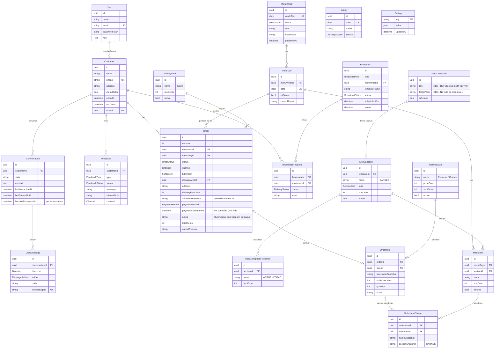

# Modelagem de Dados (rascunho)

> Versão para validar. Ela será convertida em `prisma/schema.prisma` na Etapa 1 do [plano](./PLANO_DO_PROJETO.md).
> Atualizado em 2026-11-23: cardápio personalizável (RN-11), tamanhos de marmita (RN-39), configurações editáveis (§6 do estudo), envio ativo (RN-27) e pausa do bot (RN-29).
> Atualizado em 2026-11-24: escolhas da marmita (RN-70 a RN-73), entrega por região (RN-75), envio só semanal (RN-27).

## Princípios

1. **Usuário ≠ Cliente.** `User` é quem faz login (com um `role`). `Customer` é quem compra. Um cliente de WhatsApp existe **sem** `User`. No futuro, ao criar uma conta, o `Customer` é vinculado ao `User` pelo telefone.
2. **Papéis via enum `Role`** (`ADMIN`, `STAFF`, `CUSTOMER`), o que permite as interfaces futuras sem mudar a estrutura.
3. **Cardápio dirigido por modelo.** Seções (colunas) e itens fixos ficam no `MenuTemplate`; cada semana é gerada a partir dele e pode ser editada livremente.
4. **Pedido guarda um retrato** (nome, tamanho e preço) no momento da compra, para que editar o cardápio ou preços não altere pedidos antigos.
5. **Configurações no banco** (`Setting`), com valores padrão no código: nada que mude com frequência fica fixo no código.
6. **Canal de origem** em pedidos e feedbacks (`WHATSAPP`, `SITE`, `BALCAO`).
7. Datas de cardápio usam `date` (sem hora), no fuso `America/Sao_Paulo`.

## Diagrama

## Enums

| Enum | Valores |
|------|---------|
| `Role` | `ADMIN` (gerente, acesso total, RN-62), `STAFF` (reservado para funcionários), `CUSTOMER` (futuro) |
| `PaymentMethod` | `ON_PICKUP` (na retirada), `ON_DELIVERY` (na entrega), `PIX` |
| `MenuStatus` | `DRAFT`, `PUBLISHED` |
| `OrderStatus` | `TODO` (Para fazer), `IN_PREPARATION` (Em preparação), `DONE` (Finalizado), `CANCELLED` |
| `Channel` | `WHATSAPP`, `SITE`, `BALCAO` |
| `Fulfillment` | `PICKUP` (retirada), `DELIVERY` (entrega) |
| `FeedbackType` | `REQUEST` (Solicitação), `COMPLIMENT` (Elogio), `COMPLAINT` (Reclamação) |
| `FeedbackStatus` | `NEW`, `READ`, `RESOLVED` |
| `Direction` | `INBOUND`, `OUTBOUND` |
| `MessageAuthor` | `CUSTOMER`, `BOT`, `HUMAN` (gerente pelo app, recebida como eco na coexistência) |
| `BroadcastKind` | `WEEKLY_MENU` (outros tipos podem ser adicionados depois) |
| `BroadcastStatus` | `SCHEDULED`, `SENDING`, `DONE`, `FAILED` |
| `DeliveryStatus` | `PENDING`, `SENT`, `DELIVERED`, `READ`, `FAILED` |
| `HolidaySource` | `NATIONAL_API`, `MANUAL` |
| `SectionKind` | `CHOICE` (cliente escolhe, ex.: Carnes), `INCLUDED` (vai por padrão, ex.: Complementos), `SEPARATE` (vai separado, ex.: Saladas) |

## Seed inicial (reproduz o cardápio atual)

| Seção | Ordem | Itens fixos |
|-------|-------|-------------|
| CARNES (`CHOICE`) | 1 | BIFE ou FILÉ de FRANGO (última linha) |
| COMPLEMENTOS (`INCLUDED`) | 2 | ARROZ – FEIJÃO (primeira linha) |
| SALADAS (`SEPARATE`) | 3 | SALADAS VARIADAS |

- `MenuTemplate.title`: "RBS – REFEIÇÕES BEM SERVIR"
- `MenuTemplate.footerNote`: "OBS.: Na falta de produtos no mercado, o cardápio poderá sofrer alterações."
- `MarmitaSize`: Pequena, Grande (preço cadastrado e editado pela gerente no painel)

## Observações

- `MenuItem.isFixed` indica que o item veio do modelo; a gerente ainda pode editá-lo ou removê-lo naquele dia.
- `MenuWeek.title` e `footerNote` são copiados do modelo ao criar a semana, para que mudar o modelo não altere semanas já impressas.
- `OrderItemChoice` guarda as **carnes escolhidas** (até `orders.maxMeatChoices`, padrão 2, RN-70), com retrato do nome. Complementos não são gravados um a um: vão todos por padrão (RN-71), e exceções ficam na observação do pedido (RN-73).
- `MenuSection` ganhará um campo para marcar qual seção é "de escolha" (Carnes) e qual vai por padrão (Complementos) ou separada (Saladas), para que isso continue funcionando se as seções forem renomeadas.
- `DeliveryArea` é a **lista de bairros atendidos** (RN-76). `feeCents` começa em `0` (sem taxa, RN-77) e permite taxa por bairro no futuro. `Order.deliveryFeeCents` guarda a taxa cobrada no momento do pedido.
- `Conversation.state` guarda o passo atual da máquina de estados (ex.: `MAIN_MENU`, `ORDER_CHOOSE_SIZE`). `botPausedUntil` implementa RN-29. `handoffRequestedAt` marca a conversa como "aguardando atendimento" (RN-80).
- Os **dados do Pix não ficam no banco** (RN-79): são lidos do `.env`.
- `ChatMessage.waMessageId` único garante **idempotência**: o WhatsApp pode reenviar o mesmo webhook.
- `Setting` guarda configurações e textos do bot por chave (`orders.cutoff.time`, `bot.greeting`...). Lista em [Onde alterar configurações](./ESTUDO_DE_NEGOCIO.md#6-onde-alterar-configurações).
- `Order.number` é sequencial e legível ("Pedido #42") para impressão e conversa.
