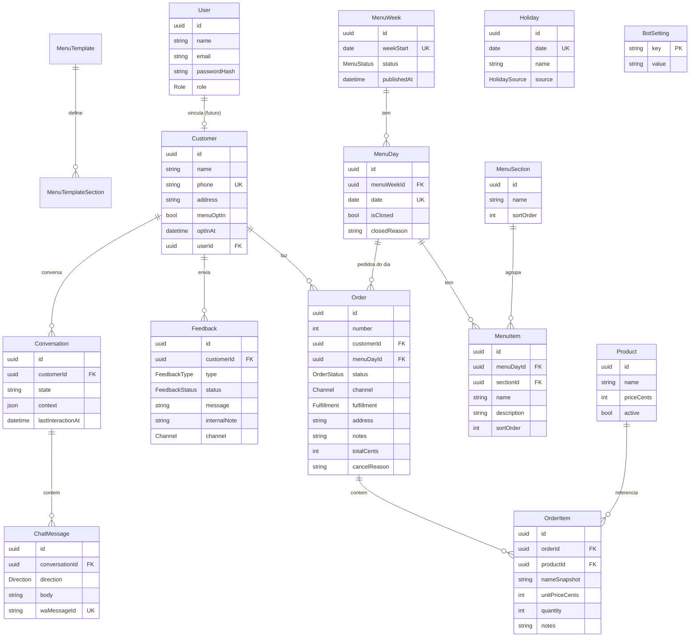

# Modelagem de Dados (rascunho)

> Primeira versão, para validar. Ela será convertida em `prisma/schema.prisma` na Etapa 1 do [plano](./PLANO_DO_PROJETO.md).
> Campos marcados com `?` são opcionais.

## Princípios

1. **Usuário ≠ Cliente.** `User` é quem faz login (com um `role`). `Customer` é quem compra. Um cliente de WhatsApp existe **sem** `User`. No futuro, ao criar uma conta, o `Customer` é vinculado ao `User` pelo telefone.
2. **Papéis via enum `Role`** (`ADMIN`, `STAFF`, `CUSTOMER`), o que permite as interfaces futuras sem mudar a estrutura.
3. **Pedido guarda um retrato** (nome do item e preço) no momento da compra, para que editar o cardápio não altere pedidos antigos.
4. **Canal de origem** em pedidos e feedbacks (`WHATSAPP`, `SITE`, `BALCAO`).
5. Datas de cardápio usam `date` (sem hora), no fuso `America/Sao_Paulo`.

## Diagrama

## Enums

| Enum | Valores |
|------|---------|
| `Role` | `ADMIN`, `STAFF`, `CUSTOMER` |
| `MenuStatus` | `DRAFT`, `PUBLISHED` |
| `OrderStatus` | `TODO` (Para fazer), `IN_PREPARATION` (Em preparação), `DONE` (Finalizado), `CANCELLED` |
| `Channel` | `WHATSAPP`, `SITE`, `BALCAO` |
| `Fulfillment` | `PICKUP` (retirada), `DELIVERY` (entrega) |
| `FeedbackType` | `REQUEST` (Solicitação), `COMPLIMENT` (Elogio), `COMPLAINT` (Reclamação) |
| `FeedbackStatus` | `NEW`, `READ`, `RESOLVED` |
| `Direction` | `INBOUND`, `OUTBOUND` |
| `HolidaySource` | `NATIONAL_API`, `MANUAL` |

## Observações

- `MenuTemplate` / `MenuTemplateSection` guardam o **formato prévio**: quais seções existem e quais itens vêm pré-preenchidos. "Nova semana" cria `MenuWeek` + 5 `MenuDay` + `MenuItem` a partir dele.
- `Product` representa o que se vende (ex.: "Marmita P", "Marmita G"). Depende de Q-02 e Q-05: se cada prato tiver preço próprio, `MenuItem` passa a referenciar `Product`.
- `Conversation.state` guarda o passo atual da máquina de estados do chatbot (ex.: `MAIN_MENU`, `ORDER_CHOOSE_SIZE`). `context` guarda o pedido em montagem.
- `ChatMessage.waMessageId` único garante **idempotência**: o WhatsApp pode reenviar o mesmo webhook.
- `BotSetting` é chave/valor para os textos editáveis do bot (`greeting`, `option_1_label`, ...).
- `Order.number` é sequencial e legível ("Pedido #42") para impressão e conversa.
